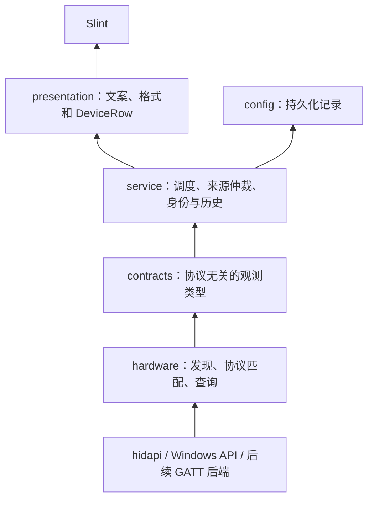

# 硬件适配与应用业务分层设计

状态：设计草案，未修改运行时代码。2026-10-25。

设计依据：当前工作区 `ecad9c6`，并纳入已合并 PR #2（`a0c53e3`，合并提交 `d290057`）的蓝牙系统属性与 HID++ 多槽位需求。当前本地 main 尚未包含该合并提交；实施时应先在包含 PR #2 的基线上迁移。

## 1. 目标与边界

硬件层负责发现端点、选择协议、执行查询和报告事实。应用层负责设备记录、身份归并、备注、历史读数、刷新策略与展示状态。新增协议不应要求应用层识别该协议，也不应在 Slint 中增加厂商判断。

统一的是设备观测契约。USB HID、蓝牙系统属性与 BLE GATT 可以通过完全不同的 API 获得同一种事实，无须实现相同的字节流接口。

首期只迁移现有只读电量能力，不实现 BLE、动态插件、通用 RPC 或灯效配置框架。后续若新增写能力，再定义独立命令契约；不要提前加入任意字节写接口。

## 2. 当前耦合及影响

| 位置 | 当前情况 | 影响 |
| --- | --- | --- |
| `vendor::VendorAdapter` | 接口暴露 `HidApi` / `DeviceInfo` | 只能抽象 HID 产品线，蓝牙系统属性无法接入 |
| `vendor::Outcome` | 返回最终 UI 文案，`no_battery` 同时参与在线判断 | 适配器承担展示决策；读取失败与不支持难以区分 |
| `devices.rs` | 混合 Windows API、接口分组、协议分发和 Reading 构造 | 新增一种数据源需要修改扫描核心 |
| `model::Reading` | 强制 VID/PID，设备类别混入 `bt-headset` | 身份和设备类别受传输方式影响 |
| `model::Device` / `app.rs` | `fresh` 同时表示在线、可用电量和成功读取 | 在线但缺少本轮电量时，历史值可能被当成当前值 |
| PR #2 多槽位 | physical_id 是否带槽号取决于本轮结果数量 | 同一槽位的路由键会随其他设备上下线变化 |

现有 `protocol.rs` 已经是纯报文函数，可继续复用。身份冲突保护、历史保留和配置原子保存也应保留其行为，不必重写已验证的逻辑。

## 3. 依赖方向



图中箭头表示数据流。代码依赖上，`hardware` 与 `service` 都依赖纯类型模块 `contracts`，二者不互相依赖；`hardware` 不引用 `service`、`config`、`presentation` 或 Slint。由应用启动代码装配来源和服务。

## 4. 模块组织

先在同一个 crate 内拆模块，避免首期引入多 crate 构建和动态加载。

```text
src/
  contracts.rs                 # Observation、身份证据、状态与错误类型
  hardware/
    mod.rs                     # HardwareSource、SourceBatch、来源注册
    hid/
      mod.rs                   # HidSource，枚举、端点分组与分发
      transport.rs             # open_pair / send / drain / KzziLink
      adapters/                # 现有 vendor 适配器；HID 类型止于这一层
    windows_bluetooth_audio.rs # Windows 缓存属性数据源，不模拟报文协议
  protocol.rs                  # 保留纯报文构造、解析；规模增大后再按家族拆分
  service/
    mod.rs                     # 刷新入口、来源工作线程与结果仲裁
    identity.rs                # 将身份/路由证据绑定到应用 DeviceId
    devices.rs                 # 当前事实与历史归并；无硬件 API
  presentation.rs              # DeviceRow、状态文案、时间与标识格式
  config.rs                    # 配置版本、序列化与原子保存
  app.rs                       # 事件连接、窗口和托盘生命周期
```

`contracts` 只依赖标准库及确有需要的序列化类型，不包含 `HidApi`、Windows 句柄、Slint 类型或中文状态文案。先用模块可见性限制边界，暂不为此新增依赖。

## 5. 硬件层对外接口

顶层按数据获取方式注册来源，例如 `HidSource`、`WindowsBluetoothAudioSource`，以后可增加 `BleGattSource`。厂商与报文协议留在各来源内部，不再成为软件业务的分支条件。

下列 Rust 为接口草图，相关类型含义见后文，不是已落地 API：

```rust,ignore
pub trait HardwareSource: Send {
    fn id(&self) -> SourceId;

    // 被动标识枚举，供 --list-devices 和诊断使用；不发送设备查询报文。
    fn inventory(&mut self, ctx: &ScanContext) -> InventoryBatch;

    // 返回本轮事实，包括部分成功、失败范围和每个逻辑设备的结果。
    fn scan(&mut self, ctx: &ScanContext) -> SourceBatch;
}

pub struct SourceBatch {
    pub source: SourceId,
    pub generation: u64,
    pub scopes: Vec<ScopeReport>,
    pub observations: Vec<DeviceObservation>,
    pub issues: Vec<HardwareIssue>,
}
```

`ScanContext` 包含本轮 generation、单调时钟 deadline 和取消信号。每次重试使用剩余预算，不能每轮重置超时。单个来源失败不丢弃其他来源的结果。

`InventoryBatch` 返回端点标识及范围错误，不伪装成成功电量读取。`SourceBatch` 表达预期的硬件失败；初始化失败也通过来源级 issue 和失败范围返回，不能转换成“扫描成功但没有设备”。

`HidSource` 内部可以继续使用专用 `HidAdapter`：输入完整端点组，输出零到多台逻辑设备的观测及明确的错误。HID 适配器使用 `DeviceInfo` 是合理的，因为它不再是全项目的统一接口。

端点分组后再选适配器；适配器自行选择组内读写集合，避免扫描层先挑 `interfaces[0]`。同一端点组被多个适配器匹配时报告冲突，不依赖注册顺序默默取第一项。

## 6. 统一观测模型

`DeviceObservation` 表示本轮获得的事实，不包含历史值、用户备注或最终展示文案。

| 字段 | 内容 |
| --- | --- |
| observation_key | 来源内的端点与目标路由键，用于关联本轮观测和来源状态 |
| identity_claims | 零到多个带命名空间、主体和作用域的身份凭据 |
| descriptor | 名称、设备类别、链路信息、可选硬件标识 |
| connection | Connected / Disconnected / Unknown，附观测时间与证据来源 |
| battery_support | Supported / Unsupported / Unknown，表示当前逻辑设备的能力 |
| battery | Value / Unavailable / NotSupported，表示本轮电量结果 |
| observed_at | 应用完成本次观测的时间；不等于设备采样时间 |

类别使用 `Mouse / Keyboard / Gamepad / Headset / Unknown` 等枚举，连接方式独立描述为 USB、2.4G 接收器、经典蓝牙、BLE 或未知。HID 是访问协议，不等同于 USB 或 2.4G；必须依据来源证据填写链路，不能看到 HID 就标记 2.4G。

VID/PID 是可选标识。标识包含编号体系，如 `UsbIf`、`BluetoothSig`，禁止把蓝牙 company ID 与 USB VID 当成同一个命名空间。属性缺失使用 None，不能用零伪装成有效标识。

### 6.1 连接、能力与读数分别表达

```rust,ignore
pub enum ConnectionState { Connected, Disconnected, Unknown }
pub enum Support { Supported, Unsupported, Unknown }

pub enum BatteryReading {
    Value(BatterySample),
    Unavailable(ReadFailure),
    NotSupported,
}

pub enum SampleOrigin {
    DirectResponse,
    SystemCache,
}
```

`BatterySample` 包含受校验的 `BatteryPercent`、来源及可选 `sampled_at`。`BatteryPercent` 私有封装数值，只允许 0..=100；如果某协议把零定义为未知，应在该协议解析器中转换为 Unavailable，不能在公共层排除 0%。

`ReadFailure` 用枚举区分 Timeout、MissingProperty、PermissionDenied、InvalidResponse、TransportFailure、Cancelled 等。可以携带诊断码，但 UI 文案由 presentation 生成；不得通过字符串包含“未响应”判断错误类型。

Unsupported 必须有型号或能力查询证据。超时、属性缺失和没有读数都不能推导不支持。即使电量失败，独立的探活结果仍可证明设备 Connected；反之，收到缓存电量不能证明设备 Connected。

公共构造器校验状态一致性：Value 必须对应 Supported；NotSupported 必须对应 Unsupported；Unavailable 允许 Supported 或 Unknown。Disconnected 仍可以携带系统缓存值，但业务层不得将它展示成在线当前读数。观测键与身份凭据不能为空的字段也在契约边界校验，避免适配器用无效默认值拼出“成功”。

### 6.2 缓存和时间

业务层保留 `last_good_battery`，另存当前观测状态，不把历史电量回填成当前硬件观测。

- 直接请求应答：可以记录本次收到应答的时间；如没有设备采样时间，不声称它就是设备实际采样时刻。
- 系统缓存属性：标记 SystemCache。系统未提供数据时间戳时，sampled_at 为 None；重复读取同一缓存不能证明设备重新上报，也不能刷新为“设备刚更新”。
- 本轮没有电量：可以继续显示上次值，但明确使用历史样式和上次时间；在线统计仍根据连接事实计算。
- presentation 区分应用读取时间和可确认的样本时间。无法判断年龄的系统值使用“系统读数”等必要反馈，不捏造精确新鲜度。

删除 `no_battery`。用明确类型代替当前 `fresh` 对在线和电量有效性的混合表达；如 UI 仍需要布尔字段，由 presentation 从独立状态计算。

## 7. 端点、目标路由和持久身份

必须区分三个概念：

1. 端点：操作系统能访问的接口/节点，一个外设可能有多个端点。
2. 目标路由：通过哪个接收器和槽位访问逻辑外设，一个端点也可能服务多个外设。
3. 应用 DeviceId：绑定备注与历史的持久记录，由应用身份服务决定。

硬件层提供证据，不能直接生成最终业务 DeviceId，也不读取历史备注来猜设备。

`identity_claims` 至少包含命名空间、值、身份主体（外设本体/接收器）、有效作用域和证据类型。协议 UID、USB 序列号、经典蓝牙地址、系统设备标识具有不同语义；接收器序列号不能直接充当槽内外设序列号。

身份服务按证据强度和作用域复用现有冲突保护：

- 本体唯一身份优先；UID 的命名空间按已确认的厂商/协议定义，不能默认所有 UID 都以 USB VID 为域。
- 序列号检查重复和名称伪序列号；强身份相互矛盾时，不通过位置兜底覆盖冲突。
- USB 父口与槽位只是弱绑定证据。没有本体身份时，无法保证换设备后仍能识别；保留冲突/手动重绑机制，不承诺靠位置解决物理身份。
- 经典蓝牙地址可作为该传输中的身份依据。BLE 随机/私有地址不能默认作为永久身份，应使用系统提供的稳定绑定或经验证的本体标识。
- 同一设备通过 HID、系统属性和 GATT 同时出现时，只有共享可靠身份或明确系统关联证据才能自动合并；不能按名称、型号或 VID/PID 合并。

槽位路由无论本轮发现几个设备都要稳定包含槽号；重新配对后如不能证明还是原外设，不自动沿用该槽的本体身份。协议 UID 可用时，允许同一本体换槽继续绑定原 DeviceId。

接收器没有配对设备时返回空逻辑设备集合和接收器诊断，不能构造一台假的鼠标作为失败占位。已知槽位的查询失败需要保留该目标的明确失败结果，不因 Vec 为空而丢失失败语义。

## 8. 扫描范围与故障隔离

每个 `ScopeReport` 说明来源中的扫描范围，如全部 HID 端点、某个接收器的槽位集合或某个蓝牙设备组；记录 Completed / Failed / Interrupted，以及它能证明的清单完整性。

业务层只在来源确实保证完整且具有相应连接语义时，使用“本轮缺席”推导设备离线。例如完整的端点枚举可证明端点消失，但接收器仍在不代表鼠标在线；BLE 扫描没发现广播通常也不能证明设备离线。

失败或中断范围内的旧记录转为状态未知/读取失败并保留历史，不将它们全部标记离线。成功范围中的明确连接或断开事实照常生效。来源级与接收器级 issue 不生成虚假逻辑设备。

初期沿用标准库线程与 channel：每个实际来源使用一个长驻工作线程，来源之间独立交付结果；同一来源内保持有序，接收器共享句柄不并发交叉发送。硬件层内部决定接口和协议的串行约束。

generation 用于忽略已被取代的结果；同一来源不得有多个未完成任务同时操作设备。新刷新请求合并成一次待处理请求，取消为协作式。不能通过忘记一个阻塞线程，再无限启动新线程实现超时。

deadline 只有在底层 API 支持有界调用、取消或循环检查时才能真正限制 I/O。对无法取消的同步系统调用，如实记录限制并隔离来源；不要把接口中的 deadline 当成已兑现的硬超时保证。

## 9. 应用业务职责

应用服务接收 SourceBatch，按以下顺序处理：

1. 校验来源与 generation，处理范围完整性和结构化错误。
2. 通过身份证据关联 DeviceId，保留冲突与手动恢复。
3. 合并当前观测、连接事实、最近成功读数和来源健康状态。
4. 同设备多来源提供值时，保留来源证据；优先可确认更新的值，同等时间证据下优先直接应答。无法比较的值按稳定策略选择，保留分歧诊断，不把最新查询时间当成最新采样时间。
5. 将持久记录交给 config，将展示投影交给 presentation。

presentation 只依赖服务提供的设备视图，统一生成连接文案、历史样式、时间、图标与可执行操作。窗口和托盘使用同一投影，避免两套在线/电量判定。

服务与 presentation 不引用 `HidApi`、设备路径、寄存器或报文操作码。设备名称来自观测描述和通用类别回退，删除 app 中按 VID 猜厂商名称的分支。

## 10. 现有能力如何接入

| 现有路径 | 硬件层实现 | 对外结果 |
| --- | --- | --- |
| ATK、DARKRIM、AULA 等 HID | HidSource + 各自 matcher/协议解析器 | 每台外设的描述、身份证据、连接事实、电量结果 |
| KZZI 原始句柄 | HidSource 内部复用 KzziLink | 与普通 HID 相同契约；型号不提供电量时明确 Unsupported |
| Logitech 一拖多 | 一个端点组分发为多条稳定槽位路由 | 每个目标独立观测、类别与失败；未知类别保持 Unknown |
| Windows 经典蓝牙音频 | WindowsBluetoothAudioSource 读取系统属性 | 连接属性证据 + SystemCache 电量；不伪造 UID、序列号或采样时间 |
| 后续 BLE BAS | 后续 BleGattSource + 标准服务解析 | 相同观测契约；设备发现/权限/通知由该来源负责 |

产品线 matcher、已识别/已实现/已实测档位和来源证据仍有必要，但属于硬件内部及适配文档。产品线可实现能力与当前具体设备能力分别记录，不能把某一型号结论推广全家族。

## 11. 复用现有库

- HID：继续使用已有 [hidapi](https://docs.rs/hidapi/latest/hidapi/)，保留已验证的原始句柄传输特例。
- Windows 系统属性：继续使用已有 [windows-sys](https://docs.rs/windows-sys/latest/windows_sys/) / windows，不新增第三方枚举层。
- BLE：有具体需求时先比较已有 windows WinRT 能力与 [btleplug](https://github.com/deviceplug/btleplug)。后者是异步 BLE 库，支持 Windows，但不支持经典蓝牙；不得用它替代本次经典蓝牙系统属性路径。依赖、许可证和运行时成本届时评估，首期不添加。
- 状态、身份和历史规则是本应用的领域逻辑，使用小型 Rust 类型与现有 serde 即可；不引入通用插件框架、事件总线或为结构统一强加异步运行时。

## 12. 分阶段迁移与验收

每个阶段独立提交，并保持程序可运行。涉及运行时代码的阶段执行项目要求的 fmt、all-targets 测试和 Clippy；硬件与界面行为按变更补实测。

1. **引入纯契约和业务状态测试。** 在现有链路旁增加 contracts 与服务归并逻辑，不改配置结构。先证明在线与电量独立、0% 合法、未知不等于 Unsupported、历史值不冒充本轮值、失败范围不造成离线。
2. **迁移现有 HID。** 将 devices 的传输/拓扑和 vendor 移到 hardware/hid，继续复用协议函数。通过转换桥接原 Reading，逐个适配器移除 UI 文案与字符串错误判断；验证多接口分组、槽位稳定性及多设备独立失败。
3. **迁移蓝牙并统一来源入口。** 把蓝牙读取接入 HardwareSource，移除 scan 中硬编码的蓝牙追加。验证连接属性缺失、0%、非法类型/长度、缓存时间未知、断开/重连，以及一个来源失败不影响其他来源。
4. **接通服务和展示投影。** app 不再直接调用 devices、拼装来源或用 fresh 推导在线；窗口、托盘、CLI 消费统一服务视图或观测结果。完成后删除 Reading 转换桥，确保仅有一套归并规则。
5. **迁移持久身份。** 新增显式配置版本迁移，保留原 DeviceId、备注、历史及旧身份键别名。不能只按新键重建记录。版本迁移单独备份旧配置，保留现有原子写与损坏保护；覆盖重复序列号、跨 PID、同口换设备、换槽、冲突备注和重启回归。
6. **更新 ADAPTATION。** 将规范改为共同观测契约 + HID 厂商协议规则 + 系统属性规则，原有协议范例保留；BLE 待实际实施时补相应验收章节。

阶段 1–4 如仍使用旧配置，只能读写能被旧格式无损表达的数据；新身份凭据需要持久化时必须进入阶段 5，不能静默丢弃后声称身份已稳定。

最终验收标准：增加一种数据源只需实现并注册 HardwareSource，增加 HID 协议只需新增硬件内部适配器和协议函数；两者都无需修改备注、历史合并规则或在 UI 添加协议分支。新增业务能力可能需要扩展契约，这属于明确的产品能力变更，不承诺一个接口永久覆盖所有功能。
